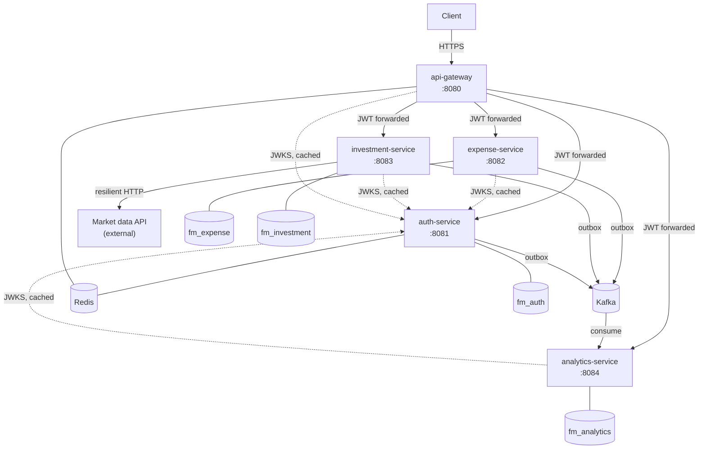
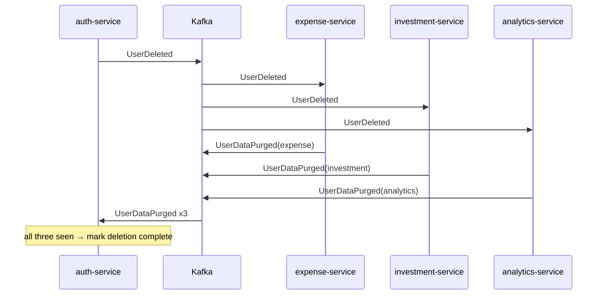

# Architecture overview

Finance Master is a personal finance system built as four business services
behind an API gateway. It is deliberately over-engineered for its domain — see
[ADR-0002](../adr/0002-microservices-from-day-one.md).

## Container view



Dotted lines are cached public-key fetches, not per-request calls.

**There are no synchronous calls between business services.** That is a hard
rule, not an accident of the current feature set —
[ADR-0004](../adr/0004-no-synchronous-service-calls.md).

## Service responsibilities

| Service | Owns | Emits | Consumes |
|---|---|---|---|
| `auth-service` | users, credentials, roles, refresh tokens | `UserRegistered`, `UserDeleted` | — |
| `expense-service` | expenses, categories, budgets, recurring rules | `ExpenseRecorded`, `ExpenseUpdated`, `ExpenseDeleted`, `BudgetExceeded` | `UserDeleted` |
| `investment-service` | instruments, holdings, trades, valuations | `TradeExecuted`, `PortfolioValued` | `UserDeleted` |
| `analytics-service` | read models and reports only | — | everything above |
| `api-gateway` | nothing | — | — |

`analytics-service` accepts no user writes. Every row it holds is derived from
events and must be rebuildable by replaying Kafka from the beginning — that
property is the acceptance criterion that makes it a real CQRS read side rather
than a second write model.

## Identity

`user_id` is a UUID present in every service, with **no foreign key** — one
cannot exist across separate databases. No service replicates the users table.
Where a display name is needed it comes from JWT claims.

The gateway validates the JWT and **forwards it**; each service validates
independently against the cached JWKS. Defence in depth, and it means a service
is safe even if reached directly, which also makes local `curl` testing possible.

## Account deletion

The one genuinely distributed workflow, and a saga with no transaction to roll
back:



## Event conventions

One topic per aggregate, event type carried in the envelope:

```
fm.auth.user.v1            key = userId
fm.expense.expense.v1      key = expenseId
fm.expense.budget.v1       key = budgetId
fm.investment.trade.v1     key = tradeId
```

Keying by aggregate id gives ordering per aggregate while allowing parallelism
across aggregates. Every event carries:

```
eventId · eventType · eventVersion · occurredAt · userId
aggregateId · correlationId · causationId · payload
```

`eventId` is what makes consumers idempotent. Delivery is **at-least-once** —
[ADR-0005](../adr/0005-transactional-outbox.md) — so every consumer keeps a
`processed_events` table and drops duplicates.

Schemas live in `platform/contracts/` as JSON Schema and are the single source of
truth. Each consumer hand-writes its own record type from the schema; that is
consumer-driven contracts, not duplication.

## API conventions

| Concern | Convention |
|---|---|
| Versioning | `/api/v1/...` from the first endpoint |
| Errors | RFC 9457 Problem Details, `application/problem+json` |
| Lists | Cursor pagination — offset drifts under concurrent inserts and degrades at depth |
| Write safety | `Idempotency-Key` header required on any POST creating financial records |
| Identifiers | UUIDv7 — time-ordered for index locality, not enumerable |
| Timestamps | UTC `Instant`, ISO-8601 on the wire |
| Money | `{"amount": "1234.50", "currency": "INR"}` — a **string**, never a JSON number |

Money as a JSON number is the one that bites hardest: most parsers decode JSON
numbers as IEEE 754 doubles, which cannot represent `0.1` exactly. Keep money as
a string on the wire and `BigDecimal` in Java, with an explicit scale and an
explicit currency. Never `double`, anywhere, for any reason.

## Local topology

Infrastructure runs in Docker; your services run on the host via `./gradlew
bootRun`. Containerising your own services locally destroys the iteration loop —
they get containerised in sprint 9 for deployment.

| Component | Port |
|---|---|
| api-gateway | 8080 |
| auth-service | 8081 |
| expense-service | 8082 |
| investment-service | 8083 |
| analytics-service | 8084 |
| Postgres | 5432 |
| Redis | 6379 |
| Kafka | 9092 |
| kafka-ui | 8090 |
| Prometheus / Grafana | 9090 / 3000 — compose profile, off by default |
